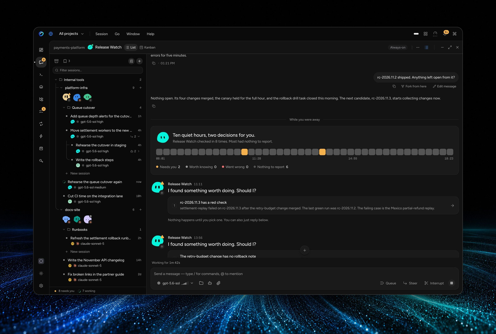
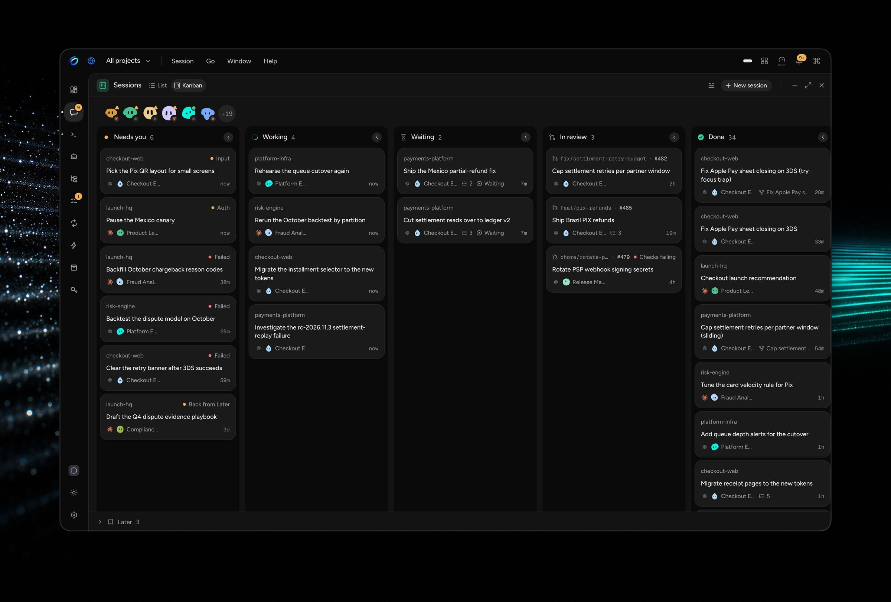
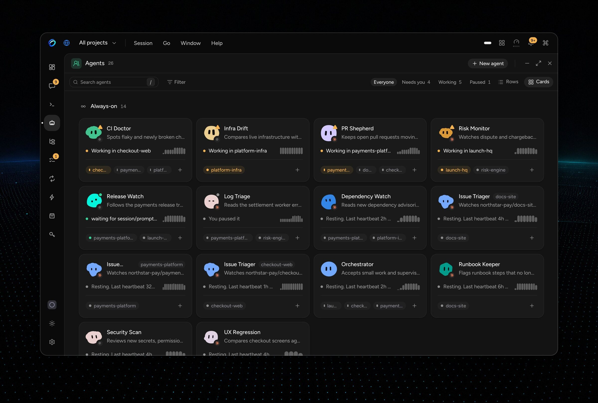
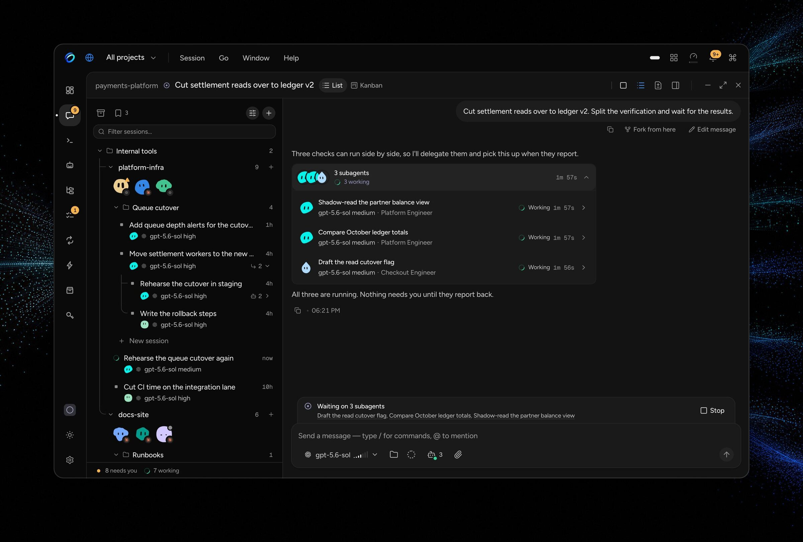
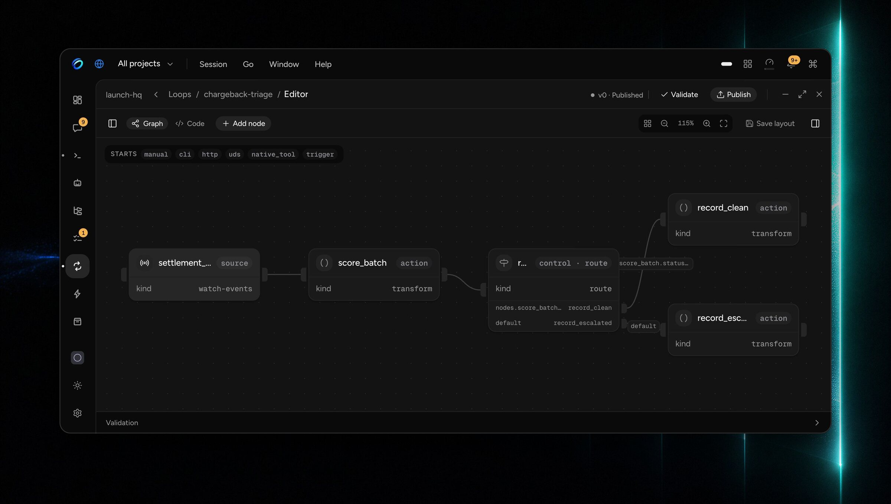
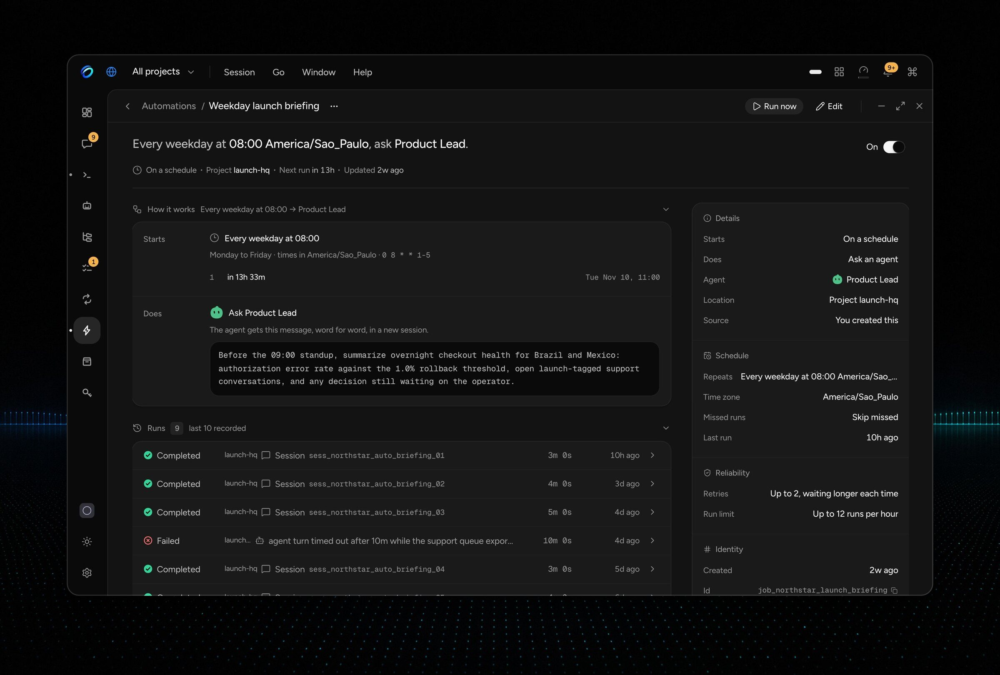
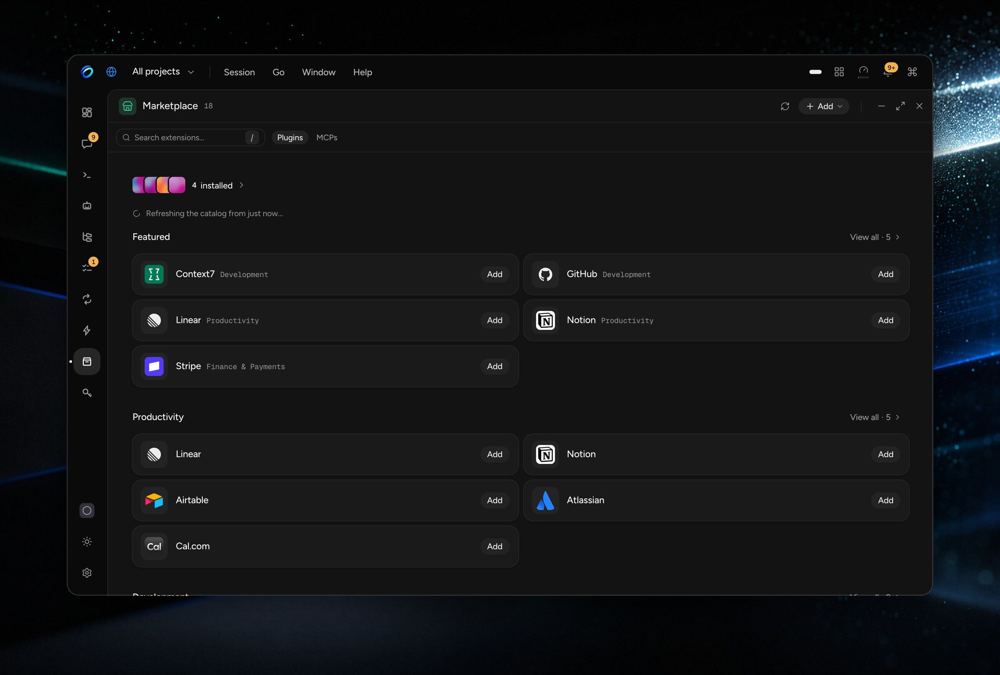
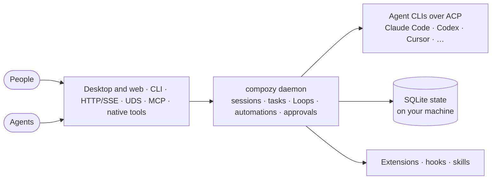

<div align="center">
  <a href="https://compozy.com">
    <picture>
      <source media="(prefers-color-scheme: light)" srcset="imgs/readme/lockup-light.png">
      
    </picture>
  </a>
  <p><sub>An operating system for AI agents</sub></p>
  <h1>The autonomous control plane for your agents.</h1>
  <p>
    See and steer every Claude Code, Codex, and Cursor session.<br>
    Always-on agents check in on their own, and you step in only when one needs you.
  </p>
  <p>
    <a href="https://compozy.com/download"><strong>Download</strong></a> ·
    <a href="https://compozy.com/docs"><strong>Docs</strong></a> ·
    <a href="https://compozy.com/marketplace"><strong>Marketplace</strong></a> ·
    <a href="https://compozy.com/changelog"><strong>Changelog</strong></a> ·
    <a href="https://compozy.com/blog"><strong>Blog</strong></a>
  </p>
  <p>
    <a href="https://github.com/compozy/compozy/actions/workflows/ci.yml">
      
    </a>
    <a href="https://github.com/compozy/compozy/releases/latest">
      
    </a>
    <a href="https://pkg.go.dev/github.com/compozy/compozy">
      
    </a>
    <a href="LICENSE">
      
    </a>
  </p>
</div>

<p align="center">
  <a href="https://compozy.com">
    
  </a>
</p>

The bottleneck stopped being the model. It became managing the sessions. Run Claude Code, Codex,
and Cursor in parallel and you end up with five terminals, a prompt typed into the wrong one, and
no clear view of which agent is waiting on you. Keeping them working means gluing loops, cron,
webhooks, and approvals together by hand.

CompozyOS replaces the pile, not one tool in it. It runs the agent CLIs you already have as
sessions that outlive the terminal, keeps every one of them visible, and calls you only when a
decision is yours. Loops, schedules, permissions, and approvals come built in, so there is no
stack to assemble around the agent.

## Install

```bash
curl -fsSL https://compozy.com/install.sh | sh
```

The verified installer pins the latest release and checks its Sigstore provenance before it
installs the binary on macOS or Linux. Prefer the desktop app?
[Download it for macOS or Linux](https://compozy.com/download).

<details>
<summary>Homebrew, npm, Go, or from source</summary>

```bash
# Homebrew
brew install compozy/compozy/compozy

# npm
npm install -g @compozy/cli

# Go, with the tag shown on https://github.com/compozy/compozy/releases/latest
go install github.com/compozy/compozy@<release-tag>

# From source
git clone https://github.com/compozy/compozy.git
cd compozy
go build -o ./bin/compozy .
```

The CLI runs on macOS, Linux, and Windows. The
[installation guide](https://compozy.com/docs/getting-started/installation) covers installer
flags, Linux packages, verification, and managed updates.

</details>

Then start one session, from the repository you want agents to work on:

```bash
compozy install        # pick a provider (the verified installer opens this for you)
compozy daemon start   # start the local daemon
compozy session new --agent general --name first-run
```

The [Quick Start](https://compozy.com/docs/getting-started/quick-start) continues through the
first prompt, live attachment, inspection, and cleanup. Today's experience is technical: a
terminal, a local daemon, and a `config.toml`.

## Every session, sorted by who owns the next step

<p align="center">
  
</p>

Every session lands in Needs you, Working, Waiting, In review, or Done. Needs you is the only
loud colour on the screen, so you know where to look.

- **Worktrees** give parallel agents their own checkout of the same repository.
- **The branch, the pull request, and its checks** sit on the session.
- **Handoff** continues a session with another agent CLI when one runs out.
- **Approvals** hold a tool call until a person allows it, and waiting work rises to Needs you.

## Agents that check in on their own

<p align="center">
  
</p>

An always-on agent has a name, a face, and one main session per project. It reviews its work on a
schedule, stays quiet when there is nothing to say, and calls you when something needs a decision.

- **Check-ins.** On a schedule, the agent reviews its project in a hidden, read-only session. A
  quiet check costs no model call.
- **Sources.** Point it at what it should watch: new GitHub issues from an extension, or a script
  you approve.
- **Reports.** Reports land in its main session. Come back after a day away and one card sums up
  what happened.
- **Proposals.** Pick a proposed action, or let the agent do it without asking, up to a daily
  limit you set.

Agents keep notes on purpose. Nothing is extracted behind your back. Check-ins need Claude, Codex,
or OpenCode. Start with
[Watch new GitHub issues](https://compozy.com/docs/guides/watch-new-github-issues).

## Agents hand work to each other, not to you

<p align="center">
  
</p>

A session delegates to subagents and watches their progress live. An agent can end its turn and
wake when a pull request's checks finish, another session settles, or a command exits, so nobody
has to sit in the terminal waiting for it.

## Loops stop when the goal is verified

<p align="center">
  
</p>

A Loop is a named contract: a goal, a way to verify it, and a stop. The daemon runs it unattended
and always ends it honestly.

- Bounded by design: every Loop carries an iteration cap.
- A human gate parks the run until someone approves, requests changes, or rejects.
- Seven named endings: done, no-op, blocked, failed, exhausted, stalled, canceled.
- The same run from the web, the CLI, and HTTP.

No Loops ship by default. Write one, fork one, or install an extension that ships one. Read the
[Loops guide](https://compozy.com/docs/loops).

## Put agent work on a schedule or an event

<p align="center">
  
</p>

Schedules, runtime triggers, and signed webhooks live in one place. Every run is recorded, and
finished runs leave your session list on their own. A briefing can be waiting for you every
weekday at 08:30, with nobody watching it start.

## Runs the agents you already use

CompozyOS starts the agent CLIs you already have as durable sessions you can see, steer, and hand
off. It is not another agent competing with them. Fifteen integrations are built in:

| Agent CLIs                                                                                                                       | Model providers and gateways                                  |
| -------------------------------------------------------------------------------------------------------------------------------- | ------------------------------------------------------------- |
| Claude Code · Codex · Cursor Agent · Gemini CLI · Google Antigravity · GitHub Copilot CLI · OpenCode · Pi · Kimi CLI · Qwen Code | OpenRouter · Vercel AI Gateway · xAI · z.ai · Moonshot / Kimi |

Your subscriptions and API keys stay yours. CompozyOS resells no model access. See
[supported agents](https://compozy.com/docs/agents/providers) for authentication and provider
setup.

## Comes with what you would otherwise build

| Built in       | What you get                                                                                                                         |
| -------------- | ------------------------------------------------------------------------------------------------------------------------------------ |
| **Sessions**   | Agent work that outlives the terminal. Fork a session, continue it with another agent, rewind to a checkpoint, or steer it mid-turn. |
| **Files**      | Browse and search the project, and review a session's diff against its base.                                                         |
| **Terminal**   | Runtime-owned shells you can open, watch, and hand to an agent.                                                                      |
| **Desktops**   | Persistent desktops with browser-style tabs and side-by-side splits, a command palette, and a global hotkey.                         |
| **Workspaces** | See all projects at once, work without a project, and give parallel agents their own worktree.                                       |
| **Tasks**      | Durable work a session claims, heartbeats, and closes with evidence.                                                                 |
| **Profiles**   | Separate work on one install. Profiles organize work; they are not a security boundary.                                              |
| **Gateway**    | The daemon starts reachable only on this machine. Remote access is off until you turn it on.                                         |

And the smaller things: park a session for Later with a reason and a date, folders and bulk
actions, a vault that keeps secrets out of config files, hooks on daemon events, skills from any
source, MCP sign-in, a curated model catalog, session health, and one-click updates.

## What people run on it

- **Triage new issues as they land.** An always-on agent watches new GitHub issues. It proposes
  what to do; you pick.
- **Deliver a spec while you are away.** A conductor splits the work into slices. Each slice runs
  in its own worktree.
- **Review a change until the round is clean.** A reviewer finds, an implementer fixes. Findings
  land in a file you can open.
- **Leave a briefing waiting every weekday.** A schedule starts an agent with nobody watching.
  Every run is recorded, with retry on failure.
- **Keep release checks as claimed work.** Each concern is a task an agent claims. Runs close
  with evidence.
- **Wait for a person before a sensitive action.** A tool call can require approval before it
  runs.

The [use cases](https://compozy.com/docs/use-cases) walk through each one.

## Built to be built on

<p align="center">
  <a href="https://compozy.com/marketplace">
    
  </a>
</p>

Extensions, plugins, and MCP servers share one [Marketplace](https://compozy.com/marketplace), by
category, with one-step Add. An extension brings skills, agents, tools, hooks, and check-in
sources into the same registries your agents already use.

Write one in Go or TypeScript, with React for views:

```bash
compozy extension init hello --template tool-provider-go
compozy extension dev hello
compozy tool invoke ext__hello__search --workspace . --input '{"query":"compozy"}'
```

- **Extensions.** `@compozy/extension-sdk` (npm) and `github.com/compozy/compozy/sdk/go` are
  published and version-matched to the daemon. Start with
  [Build your first extension](https://compozy.com/docs/guides/build-your-first-extension).
- **Apps.** `@compozy/client` (TypeScript) and `github.com/compozy/compozy/sdk/go/client` (Go)
  connect an external app to your running daemon, with typed operations and agent streams. These
  surfaces are experimental; pin the version that matches your daemon. See
  [Build an app](https://compozy.com/docs/apps).
- **Agents.** The [official CompozyOS skill](skills/compozy/) teaches an agent to operate the
  runtime through the same contracts people use.

## How it works



One Go binary runs a local daemon that owns every session, task, Loop run, and approval, and
talks to agent CLIs over ACP (Agent Client Protocol). The desktop app, the web UI, the CLI,
HTTP/SSE, the Unix socket, MCP, and native tools all read and change that same state, so people
and agents manage the same work and nothing has to be glued together. State stays in SQLite on
your machine unless a provider or extension you configure owns an external boundary.

```bash
compozy status
compozy session list -o json
compozy doctor -o json
```

## Documentation

| Start                                                                 | Go deeper                                         | Reference                                                           |
| --------------------------------------------------------------------- | ------------------------------------------------- | ------------------------------------------------------------------- |
| [Installation](https://compozy.com/docs/getting-started/installation) | [Sessions](https://compozy.com/docs/sessions)     | [CLI](https://compozy.com/docs/cli)                                 |
| [Quick Start](https://compozy.com/docs/getting-started/quick-start)   | [Loops](https://compozy.com/docs/loops)           | [HTTP API](https://compozy.com/docs/api)                            |
| [Supported agents](https://compozy.com/docs/agents/providers)         | [Automation](https://compozy.com/docs/automation) | [SDKs](https://compozy.com/docs/sdk)                                |
| [Guides](https://compozy.com/docs/guides)                             | [Extensions](https://compozy.com/docs/extensions) | [Configuration](https://compozy.com/docs/configuration/config-toml) |
| [Use cases](https://compozy.com/docs/use-cases)                       | [Gateway](https://compozy.com/docs/gateway)       | [Changelog](https://compozy.com/changelog)                          |

> [!NOTE]
> Coming from v0.2? That product has reached end of life and receives no further releases. Read
> the [migration guide](MIGRATION_GUIDE.md) before replacing an existing v0.2 installation.

## Development

CompozyOS is a Go and Bun monorepo. Start the daemon with automatic Go rebuilds and the web UI
with Vite HMR:

```bash
make dev
```

To explore the product with realistic data, seed the Northstar Pay demo. It builds the daemon and
web bundle and serves the demo at `http://localhost:2124` from `~/.compozy-demo`, leaving your
main instance unchanged:

```bash
make demo-seed            # web UI
make demo-seed-desktop    # the same demo in the Electron desktop shell

# Optional isolated home and port:
make demo-seed DEMO_HOME="$HOME/.compozy-demo-other" DEMO_PORT=2125
```

The demo daemon keeps running in the background. Stop it before reseeding:

```bash
COMPOZY_HOME="$HOME/.compozy-demo" ./bin/compozy daemon stop
```

Read [AGENTS.md](AGENTS.md) and the surface-specific instructions before editing. Run focused
tests and lint for what you changed; CI owns the full gate, and a pull request is done when every
required check passes on its current head.

## Contributing

Contributions are welcome. Open an issue or a pull request, and keep public behavior manageable
by agents through the CLI, HTTP, and UDS surfaces. [Security reports](SECURITY.md) belong in the
repository's private security channel, not a public issue.

<a href="https://github.com/compozy/compozy/graphs/contributors">
  
</a>

## License

CompozyOS is distributed under the [MIT License](LICENSE).
