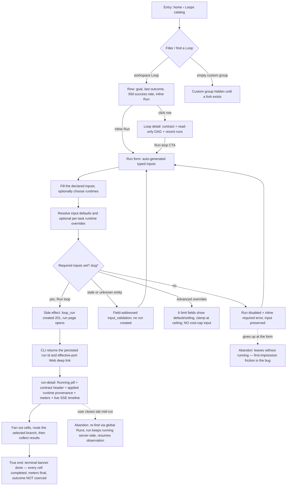

# J-01 — Arrive and use: run a Loop from the catalog

A user arrives at the Loops catalog, launches a workspace Loop that fans out work, and watches it finish. Spec delivery no longer runs as a Loop: `J-deliver-through-agents` owns it. Earlier reports describe the retired bundled Loop.

For the v0.3 migration candidate, the same journey also proves that one run can resolve distinct
per-task runtimes, persist the applied provider/model/reasoning provenance, expose it identically
through structured and Web reads after restart, and hand the operator a truthful deep link.



```yaml
journey:
  id: J-01
  name: "Run a fan-out workspace Loop from the catalog"
  value_statement: "A user runs a workspace Loop with a required input, optionally chooses runtimes, and gets every fan-out cell finished with truthful provenance."
  personas: [Lea, Bruno]
  entry_points:
    - url: "web /loops (loops-catalog)"
      origin: in-app-nav
    - url: "web /loops/:name (loop-detail) › Run loop"
      origin: in-app-nav
    - url: "CLI: compozy loop run --name <loop> --input slug=my-feature --runtime <selector>=<provider/model/reasoning>"
      origin: direct
    - url: "HTTP/UDS: POST /api/workspaces/:workspace_id/loops/:name/run"
      origin: direct
  actions:
    - step: 1
      verb: "Browse the catalog and find the workspace Loop"
      expected_observable: "The catalog shows the Loop with its goal, last-outcome pill, 30d success-rate, and inline Run"
    - step: 2
      verb: "Open the run form and fill the declared inputs"
      expected_observable: "The shared controls show every declared input and its partial runtime selectors; Run stays disabled only until the required input exists"
    - step: 3
      verb: "(optional) Open Advanced overrides"
      expected_observable: "6 numeric fields each show per-loop default / daemon ceiling and clamp at ceiling; NO Cost cap (USD) input; canonical defaults render (iteration cap 50, unbounded as ∞)"
    - step: 4
      verb: "Preview optional per-task runtime overrides"
      expected_observable: "Dry-run reports the ordered effective runtime layers and input origins, and proves the executed definition can be saved and loaded without creating a run or ACP session"
    - step: 5
      verb: "Run the Loop"
      expected_observable: "loop_run created (201); CLI/JSON/TOON identify the same persisted run and effective-port Web URL; the run page shows applied runtime provenance as read-only truth"
    - step: 6
      verb: "Watch every task execute and finish"
      expected_observable: "The selected branch completes, the other branch is not_taken, and a terminal banner shows done"
  goal:
    observable: "Terminal banner reads done after every cell completed; applied runtime provenance and Attempts/Tokens/Wall/Cost/Breadth meters show final truth"
    side_effects: [loop_run-created, task_runs-executed, generation-timeline-events-streamed]
  true_end_state: "Restart the daemon and reload the CLI, HTTP/UDS, native status, SSE-backed run page, and printed deep link: the run is still done, every surface agrees on the selected delivery path, not_taken branch, and persisted runtime provenance, no review/verify/approve nodes appear, and another workspace cannot observe it."
  exit:
    natural: "User lands on the terminal run page; can open the merged result / recent-runs history."
  abandonment:
    - at_step: 2
      how: "New user can't tell what to type or what the primary action is; leaves."
      resume: "No run created; the friction itself is the finding (arrive-and-use must be ≤ Compozy)."
    - at_step: 4
      how: "Closes the browser tab while the run is still running."
      resume: "Run continues server-side; user re-finds it via global Runs (runs.html) and resumes observing — state and meters intact."
  crosses: [catalog-projection, run-form-schema, runtime-resolver, executed-definition-snapshot, daemon-binder, CLI, HTTP, UDS, native-tools, coordinator/task_runs, SQLite-provenance, generation-history, SSE-stream, web-run-inspect, global-runs-index]

design_reference:
  screens:
    - "docs/design/opendesign/loops-catalog.html (LOOPS-DESIGN-SPEC §4.1)"
    - "docs/design/opendesign/loop-run-form.html (LOOPS-DESIGN-SPEC §4.3)"
    - "docs/design/opendesign/run-detail.html (LOOPS-DESIGN-SPEC §4.4)"
  truthful_ui_checks:
    - "No Cost cap (USD) input on the run form; Cost is a display-only derived meter (ADR-017 §3)."
    - "Canonical stop-limit defaults render (iteration_cap 50, not the design HTML's 10; unbounded shown as ∞) — §9.5.1."
    - "Terminal banner is truthful: done requires every cell to complete; it is never coerced from exhausted/stalled and does not imply a separate review, verification, or approval phase."
    - "Running pulse only while live; gated by reduced-motion."
    - "Applied runtime is read-only persisted truth from the daemon binding; the Web never offers an unsupported runtime edit control."
    - "The CLI deep link uses the effective daemon port and opens this exact persisted run; dry-run never prints one."
    - "Run-agent sessions are policy-gated (permission/subset-only allowed_tools); LP-046 verifies the session posture."

e2e_backbone:
  runtime:
    - "E2E-runtime-1: Should run a fan-out Loop through routed execution and collection to a truthful terminal outcome unattended."
    - "E2E-runtime-7: budget never kills a progressing run; no-progress → stalled; ceiling → exhausted (guardrail side of self-correction)."
  web:
    - "E2E-web-1: Catalog filter + success-rate + last-outcome pill + launch run inline → run form."
    - "E2E-web-2: Run form auto-generates typed inputs, Run gated until required, override default/ceiling + clamp, NO Cost cap input, start a run on Run."
    - "E2E-web-3: Run page contract header (goal + DoD + terminal chips + live Running pill, no pulse under reduced-motion)."
    - "E2E-web-4: Run page meters (Attempts/Tokens/Wall/Cost(derived)/Breadth, warn-tint near ceiling only, cost display-only, no cap control)."
    - "E2E-web-5: Run page timeline (collapsible generations + selected delivery path + not_taken branch + carried-forward tags)."
  component:
    - "Web-unit-3 (right control per input type + block submit until required); Web-unit-4 (clamp + overrides-set badge); Web-unit-6 (meter warn-tint, no cost cap control)."
  followups:
    - "AB-001 — real-daemon Playwright for the run page needs a loop e2e seed harness that drives rich-frame SSE emission. Web-lane covers behavior at vitest/component + eng-ui-screenshot until then."
    - "LP-runtime-selection-overrides — compare one mixed batch across CLI, HTTP, and UDS."
    - "LP-runtime-provenance-observation — prove restart durability and workspace containment across every read surface."
    - "LP-loop-run-deep-link — open the effective-port URL and confirm dry-run emits none."
```

Taxonomy note (2026-08-01): the end-to-end run owns journey and functional coverage; validation,
terminal bounds, workspace denial, and close/resume own error and continuity coverage; the Web
run-detail charter owns experiential truth; CLI/HTTP/UDS/native/SSE parity owns cross-cutting
consistency. The editor remains desktop-only, while the supported run-detail viewport is covered
without claiming mobile authoring support.
