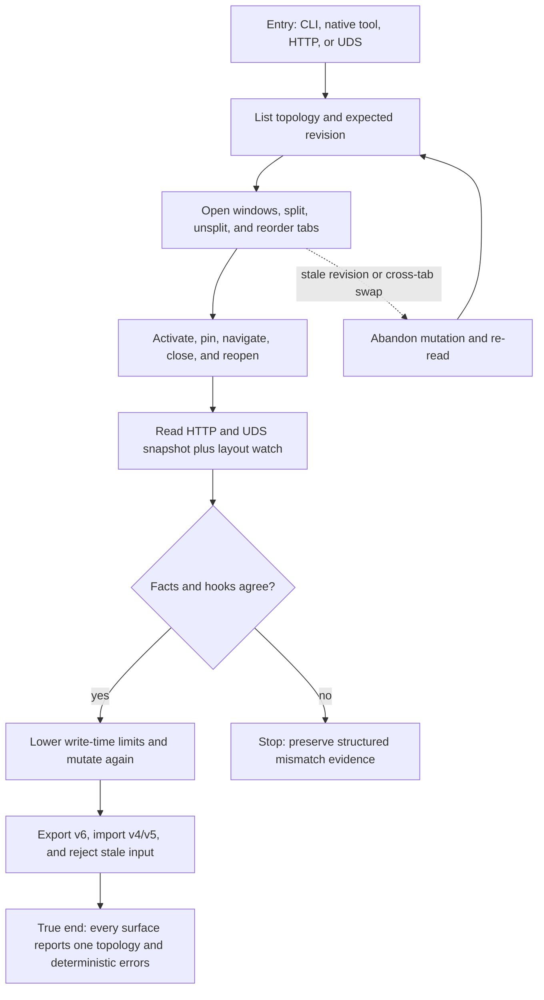

# J-agent-manage-window-tabs — Manage tab topology through structured surfaces

An autonomous agent discovers the current revision, applies the tab lifecycle through CLI or native
tools, verifies HTTP/UDS parity and hooks, and recovers deterministically from invalid or stale
commands.



```yaml
journey:
  id: J-agent-manage-window-tabs
  name: "Manage tab topology through structured surfaces"
  value_statement: "An agent can manage tabs without the web UI and can trust every public surface to expose one deterministic contract."
  personas: [Ada]
  entry_points:
    - url: "compozy window list|open|move|swap|reorder|activate|pin|unpin|navigate|close|reopen; compozy layout migration status|ack"
      origin: direct
    - url: "compozy__window_manager native tools"
      origin: direct
    - url: "/api/workspaces/{workspace_id}/window-manager over HTTP and UDS"
      origin: direct
    - url: "skills/compozy/references/window-management.md and configuration docs"
      origin: direct
  actions:
    - step: 1
      verb: "Read the topology, client view, and current revision"
      expected_observable: "Structured output exposes each desktop's tabs (id, pin, split tree), each window's `tab_id`, the client's `active_tab`, navigation depth, `closed_entry_count`, and `migration` while the upgrade notice is unacknowledged."
    - step: 2
      verb: "Split, unsplit, reorder, activate, pin, close, and reopen tabs at the expected revision"
      expected_observable: "Each command commits once with `changes.tab_ids`, `tab_split`, and `tab_unsplit`; CLI, HTTP, UDS, native tools, stream frames, and the `window_manager.tab.split`, `tab.unsplit`, and `tab.activated` hooks converge."
    - step: 3
      verb: "Submit cross-tab swap, pinned-close, stale-revision, and retired-surface commands"
      expected_observable: "Stable reason codes reject the command without topology, history, or hook side effects; retired surfaces answer `applied: false` with a `deprecations` entry naming the replacement and v0.8.0."
    - step: 4
      verb: "Change write-time limits and exercise raw-layout recovery"
      expected_observable: "New mutations enforce the live limits; `layout export` writes version 6, version 4 and 5 documents import through the converter, and other versions are rejected as unsupported."
  goal:
    observable: "All structured surfaces report the same committed topology and the same deterministic failures."
    side_effects: [tab-hooks-emitted, config-hot-applied, v6-layout-exported]
  true_end_state: "The agent can re-read the authoritative state, explain every rejection, and continue at the newest revision."
  exit:
    natural: "The agent releases the topology after confirming HTTP/UDS/CLI/native parity."
  abandonment:
    - at_step: 3
      how: "A stale revision rejects the mutation."
      resume: "The agent re-lists state, recomputes intent, and retries once at the new revision."
  crosses: [cli, http, uds, native-tools, hooks, config-lifecycle, docs, workspace-isolation]
```

qa-impact: 2026-11-13 window-tabs-split S10. Stacks, grouping, and v3 documents were replaced by tabs with split trees and v6 documents; scenarios ET-window-tab-agent-parity, ET-window-manager-public-parity, ET-window-retired-surfaces-deprecations, and ET-window-layout-upgrade-v06 carry the walk.
