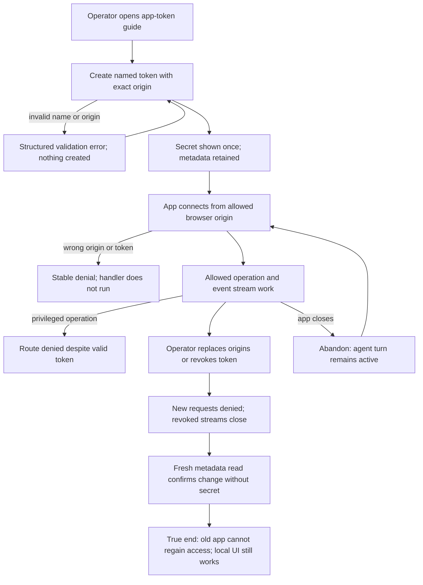

# J-authorize-browser-app: Grant and revoke local browser app access



```yaml
journey:
  id: J-authorize-browser-app
  name: Grant and revoke local browser app access
  value_statement: The operator can authorize a trusted app and reliably remove its access later.
  personas: [Dora, Ana, Ada]
  entry_points:
    - url: compozy app-token
      origin: direct
    - url: /docs/apps/browser
      origin: direct
    - url: /docs/apps/app-tokens
      origin: in-app-nav
  actions:
    - step: 1
      verb: Create a named credential allowing the app's exact origin through local CLI or HTTP/UDS.
      expected_observable: Metadata and the one-time secret are returned; later reads omit the secret.
    - step: 2
      verb: Use the token from an allowed browser and try a privileged operation.
      expected_observable: Allowed reads and streams work; the privileged request returns a route-forbidden error.
    - step: 3
      verb: Replace the origin set and then revoke the token while a stream is open.
      expected_observable: Old-origin requests fail, revocation closes the stream, and new requests reject the secret.
    - step: 4
      verb: Re-read the token list and try the local UI and tokenless local process.
      expected_observable: Revoked metadata persists without secret exposure and existing local access remains functional.
  goal:
    observable: Only the explicitly allowed app can use the permitted operations until the operator withdraws access.
    side_effects: [token-hash-persisted, origin-set-replaced, token-revoked, active-stream-closed]
  true_end_state: A fresh browser request cannot reuse the revoked secret; local CLI and same-origin Web retain their existing behavior.
  exit:
    natural: The operator leaves with an auditable credential inventory and no unintended app access.
  abandonment:
    - at_step: 2
      how: The app closes its tab while its prompt is running.
      resume: The session continues; reconnecting requires a still-valid token and recovers the durable transcript.
  crosses: [cli, http, uds, gateway, cors, device-service, sqlite, browser, docs]
```

Targeted taxonomy: the actual app/operator journey owns happy path and aftermath; exact-origin,
missing-token, forbidden-route, and revoke branches cover functional and error behavior. Metadata
round trips, same-origin Web and paired-device canaries cover cross-cutting consistency. Copy and
one-time-secret discoverability are experiential checks during the guide walk. No new app-token
management UI or mobile workflow exists in this scope.
