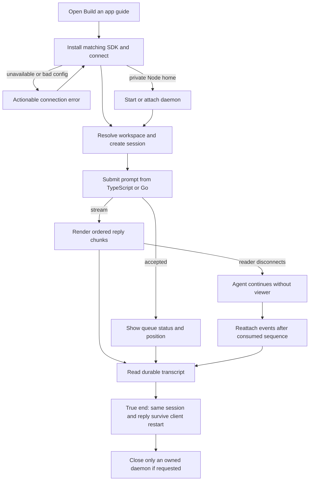

# J-build-external-app: Run and recover agent work from an external app



```yaml
journey:
  id: J-build-external-app
  name: Run and recover agent work from an external app
  value_statement: An app builder can drive durable agent work without rebuilding discovery or transport.
  personas: [Ana]
  entry_points:
    - url: /docs/apps
      origin: direct
    - url: /docs/apps/go
      origin: direct
    - url: /docs/api
      origin: in-app-nav
  actions:
    - step: 1
      verb: Install the matching published SDK and connect to the isolated daemon.
      expected_observable: The client exposes the daemon version or a typed actionable error.
    - step: 2
      verb: Resolve a project, create a session, and ask the agent for a useful result.
      expected_observable: The response streams ordered chunks or reports accepted work and queue position.
    - step: 3
      verb: Display the response in a Node script, Go program, and server-backed chat UI.
      expected_observable: Each surface shows the same session's actual reply without duplicate execution.
    - step: 4
      verb: Reconnect after abandoning the reader and inspect the durable transcript.
      expected_observable: Events resume after the consumed sequence and the completed reply is retained.
  goal:
    observable: A working external application displays the real agent result and recovers it after reconnect.
    side_effects: [workspace-resolved, session-created, prompt-admitted, transcript-persisted]
  true_end_state: A fresh client reads the same session and completed reply; cleanup leaves attached or replacement daemons running.
  exit:
    natural: The app builder can use the generated API samples for the next operation.
  abandonment:
    - at_step: 3
      how: The browser tab closes or the reader is canceled during a prompt.
      resume: The agent continues; a new event subscription and transcript read recover progress without resubmission.
  crosses: [docs, typescript-sdk, go-sdk, daemon, provider, http, uds, sse]
```

Targeted coverage: the feature charter covers the documented user journey and its expected output;
the recovery charter covers errors, reconnect, and lifecycle ownership. API sample labels and the
browser table remain within the existing site unit suite. Review page readability and keyboard
navigation during the site walk; no new product layout is introduced, so a separate mobile layout
journey is not required. Release publication is owned by `J-publish-compozy-beta`, not inferred from
repository-local package imports. Runtime evidence must name the actual package source/version.
