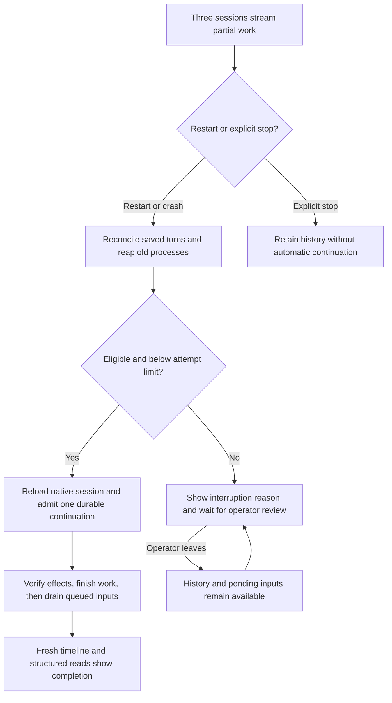

# J-daemon-restart-continuation — Keep work through a runtime restart

Dora restarts CompozyOS while several sessions are working. She expects their saved work to remain
and eligible turns to finish without resubmitting an action whose outcome is unknown.



```yaml
journey:
  id: J-daemon-restart-continuation
  name: Keep work through a runtime restart
  value_statement: My work survives a restart without repeating actions whose outcome is unknown.
  personas: [Dora]
  entry_points:
    - url: "CLI: compozy daemon restart"
      origin: direct
    - url: "Web: session permalink"
      origin: in-app-nav
  actions:
    - step: 1
      verb: Start three sessions and wait for partial output
      expected_observable: Each session is working and its partial text is visible.
    - step: 2
      verb: Restart CompozyOS and return to the same sessions
      expected_observable: Eligible sessions keep their native history and continue once; interruption is not a provider failure.
    - step: 3
      verb: Read completed results and queued follow-ups
      expected_observable: Partial text remains and queued inputs follow the continuation in their original order.
    - step: 4
      verb: Repeat with explicit stop, a pending decision, opt-out, and repeated crashes
      expected_observable: Explicit stops stay stopped; unsafe continuations pause with a reason; repeated failures reach the attempt limit.
  goal:
    observable: Eligible sessions finish once and skipped sessions remain available for review.
    side_effects: [old-processes-reaped, interruption-recorded, continuation-admitted]
  true_end_state: Fresh session and transcript reads retain results, partial text, and interruption reasons after another restart.
  exit:
    natural: Dora reads the finished work or explicitly resumes a session after reviewing its interruption reason.
  abandonment:
    - at_step: 2
      how: Dora closes the UI while recovery runs.
      resume: The next session open shows persisted progress; closing the UI did not cancel recovery.
    - at_step: 4
      how: Dora leaves an unsafe continuation paused.
      resume: History and queued inputs remain available; no action runs until she chooses to resume.
  crosses: [runtime, ACP, storage, CLI, HTTP, UDS, native-tools, Web]
```
