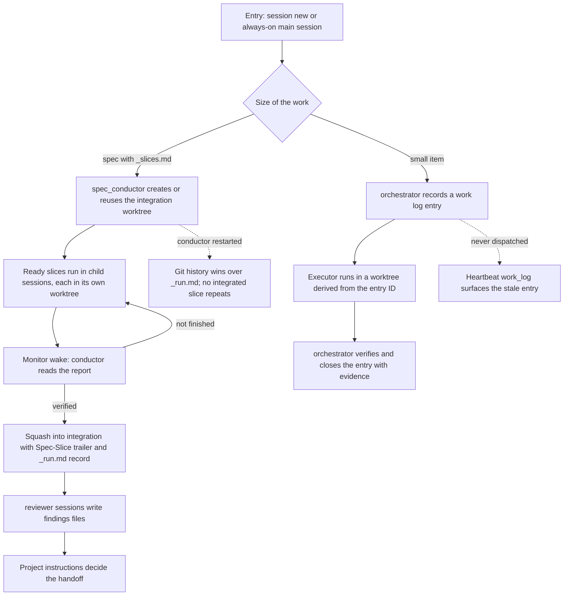

# J-deliver-through-agents — Deliver a spec and small work by choosing an agent

The operator delivers an approved spec by starting `spec_conductor`, and small work by talking to the
always-on `orchestrator`. No Loop, tool, or pasted procedure is involved. Spec files stay in the
workspace root, and every session reads them by absolute path.



```yaml
journey:
  id: J-deliver-through-agents
  name: "Deliver a spec and small work through agents"
  value_statement: "An operator picks an agent and gets verified, integrated work, with recovery after a restart and no manual procedure."
  personas: [Bruno]
  entry_points:
    - url: "CLI: compozy session new --agent spec_conductor --workspace <workspace> --name <name>"
      origin: direct
    - url: "CLI: compozy agent instance create orchestrator --workspace <workspace>"
      origin: direct
    - url: "CLI: compozy session prompt <session> <request>"
      origin: direct
  actions:
    - step: 1
      verb: "Start spec_conductor on a spec with slices"
      expected_observable: "One integration worktree exists, and ready slices run in child sessions with confirmed runtimes"
    - step: 2
      verb: "Let slices finish, and interrupt the conductor once"
      expected_observable: "Each verified slice is squashed once; a replacement conductor resumes from Git history"
    - step: 3
      verb: "Hand a small item to orchestrator"
      expected_observable: "An open entry exists before dispatch, and it closes with evidence after verification"
  goal:
    observable: "Integrated branch and closed work log entry, each backed by evidence"
    side_effects: [worktrees-created, child-sessions-created, work-log-updated, run-file-updated]
  true_end_state: "After a daemon restart, sessions, _run.md, work log, and integration history agree, and no slice or entry was delivered twice."
  exit:
    natural: "The operator reads the delivery report."
  abandonment:
    - at_step: 2
      how: "The operator stops watching while slices run."
      resume: "Monitors wake the conductor; the work continues without the operator."
  crosses: [agent-definitions, session-lifecycle, session-monitors, worktrees, heartbeat, git]
```
