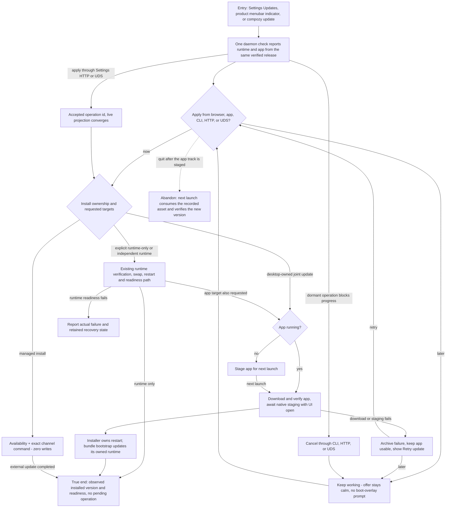

# J-desktop-update-moment: Take an update at my convenience and never get stranded

A daily user takes an update directly from the menubar or Settings, in Chrome or the app.
The daemon owns eligibility and the durable operation. For a desktop-owned runtime, a joint
update downloads one app bundle, waits for native installer readiness, and restarts once;
bootstrap provisions the bundle's runtime. Explicit runtime-only and independent runtime
updates keep their existing path. A closed app stages for next launch, and managed installs
get a recommendation rather than a write. The boot window reports progress without offering
another confirmation. A failed app attempt offers a fresh retry when the channel is free.



```yaml
journey:
  id: J-desktop-update-moment
  name: "Take app and runtime updates at my convenience"
  value_statement: "I stay current without manual downloads, my agent work is never interrupted without consent, and a failed update always leaves me a way forward."
  personas: [Bruno, Dora]
  entry_points:
    - url: "Settings → General → Updates; product menubar update indicator"
      origin: in-app-nav
    - url: "compozy update -o json"
      origin: direct
  actions:
    - step: 1
      verb: "Keep working while the daemon reports a newer release"
      expected_observable: "A calm menubar Update action is available; the boot window never offers or accepts an update"
    - step: 2
      verb: "Activate Update once from the menubar or Settings"
      expected_observable: "The action supplies restart consent; one desktop bundle downloads, native staging completes with the app open, and the new app and runtime are observed after restart"
    - step: 3
      verb: "Defer an available update or retry a settled app failure"
      expected_observable: "Deferring keeps work running; Retry update starts a freshly verified attempt without requiring Cancel staged update"
    - step: 4
      verb: "Meet a runtime update on a managed install"
      expected_observable: "Availability plus the exact channel command; no binary is touched; the surface clears after an external update"
    - step: 5
      verb: "Compare the update surface in Chrome and the app"
      expected_observable: "Both render the same daemon-owned tracks, phases, actions, and beta versions; neither surface has shell-only update behavior"
    - step: 6
      verb: "Apply or cancel through a structured settings route"
      expected_observable: "HTTP and UDS return the same accepted, blocked, or canceled operation truth"
  goal:
    observable: "One coherent update experience covering app and app-owned runtime"
    side_effects: [app-binary-replaced-on-restart, runtime-binary-swapped-under-lock, provenance-marker-updated]
  true_end_state: "The product reports observed installed versions and runtime readiness with no residual pending state. Download and native-staging failures leave the app usable and retryable; runtime failures preserve actual recovery state without claiming an unobserved rollback."
  exit:
    natural: "The user resumes work on the new versions."
  abandonment:
    - at_step: 2
      how: "Quit after the app track is staged but before the installer handoff."
      resume: "The next launch consumes only the recorded verified asset and confirms the new version — the update is not lost."
  crosses: [github-release-channel, platform-signing, quiesce-contract, update-lock-journal, install-method-detection, release-pipeline]
```
