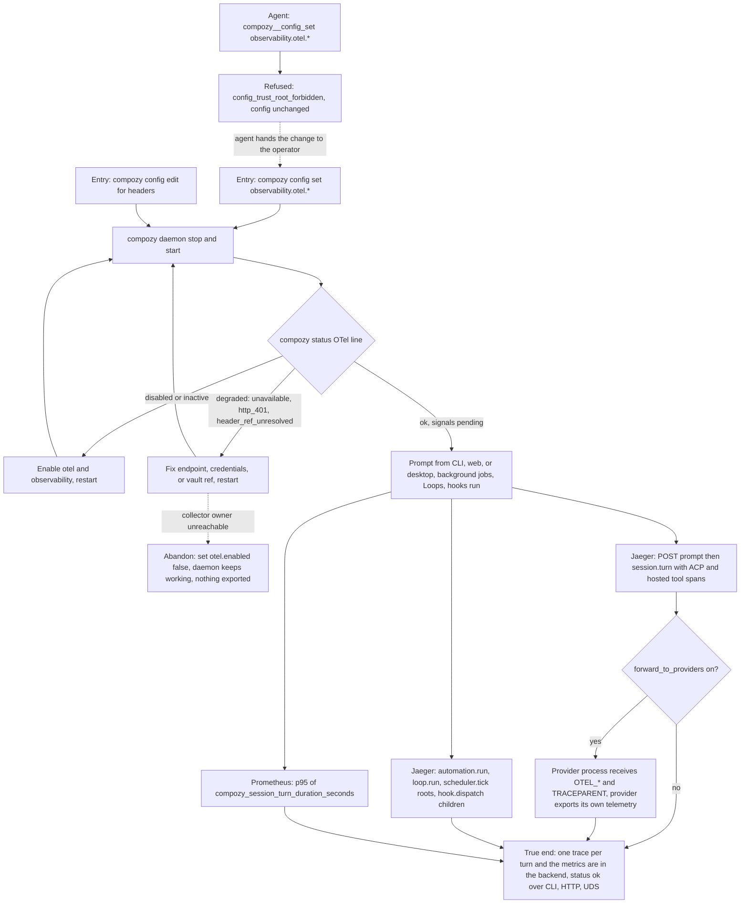

# J-export-telemetry-to-collector — Export daemon traces and metrics to an OTLP collector

A runtime administrator points the daemon at the OpenTelemetry collector they already run, restarts it,
works normally, and finds one trace per turn and the latency histograms in their backend, while
`compozy status` reports export health truthfully.



```yaml
journey:
  id: J-export-telemetry-to-collector
  name: "Export daemon traces and metrics to an OTLP collector"
  value_statement: "An operator can see where a slow turn spent its time, in the tracing and metrics backend they already run, without exporting any prompt, tool, or credential content."
  personas: [Dora, Ada]
  entry_points:
    - url: "CLI: compozy config set observability.otel.<key> <value>; compozy config edit"
      origin: direct
    - url: "CLI: compozy status; compozy status --json; HTTP/UDS: GET /api/status"
      origin: direct
    - url: "Web: session composer prompt send; Desktop app: same composer, plus its runtime health requests"
      origin: direct
    - url: "Native tool: compozy__config_set (refused), compozy__config_get (read)"
      origin: direct
    - url: "Backend UIs: Jaeger http://localhost:16686, Prometheus http://localhost:9090"
      origin: external
  actions:
    - step: 1
      verb: "Start the _dx.md Compose stack and enable export with compozy config set"
      expected_observable: "Each set returns lifecycle restart-required with next action restart-daemon."
    - step: 2
      verb: "Restart the daemon and read compozy status"
      expected_observable: "OTel line reads ok with protocol, endpoint host, per-signal state, and sample ratio; HTTP and UDS /api/status carry the same otel object."
    - step: 3
      verb: "Send prompts from the CLI, the web composer, and the desktop app"
      expected_observable: "Each prompt is one session.turn trace under its POST prompt span, with spawn, ACP prompt, and hosted tool spans nested; client requests keep their trace id."
    - step: 4
      verb: "Let automation, Loop, hook, and scheduler work run"
      expected_observable: "Background work appears as its own root traces."
    - step: 5
      verb: "Query the p95 turn latency in Prometheus"
      expected_observable: "The histogram_quantile query returns a value after a second turn inside the 5m window (NaN after the first)."
    - step: 6
      verb: "Break and repair the export (metrics off, unreachable endpoint, bad credential, forwarding on)"
      expected_observable: "Status changes to metrics off, degraded with the right error class, or adds forwarding to providers; the daemon and its turns keep working."
  goal:
    observable: "Traces and metrics for the operator's own work are visible in their backend and status reports export health on every structured surface."
    side_effects: [config-written, otlp-connections-opened, provider-env-forwarded-when-opted-in]
  true_end_state: "After a restart with export on, a fresh prompt's trace and the p95 query are visible in the backend, compozy status, status --json, and GET /api/status over HTTP and UDS agree on the otel object, and no prompt text, tool payload, path, or header value appears in the exported data."
  exit:
    natural: "The operator keeps working with export on, or turns it off with otel.enabled false."
  abandonment:
    - at_step: 6
      how: "The collector or its credential cannot be fixed now."
      resume: "Set observability.otel.enabled false and restart; status reads disabled and no connection is made. Re-enable later."
    - at_step: 1
      how: "An agent tries to enable export through compozy__config_set."
      resume: "The tool refuses with config_trust_root_forbidden; the operator applies the change with compozy config set."
  crosses: [config, vault, daemon-boot, HTTP, UDS, CLI, web, desktop, ACP, hosted-MCP, observe, scheduler, automation, loop, hooks, OTLP]
```

Taxonomy note: functional happy path (steps 1–5), error and recovery (step 6, degraded classes), structured-surface
consistency (CLI/HTTP/UDS and native tool refusal), and security (privacy on the wire, trust-root refusal, forwarding
policy statement) are in scope. UI responsiveness, mobile continuity, and screen-reader coverage are skipped: the
feature adds no rendered UI beyond the status line and request headers.
