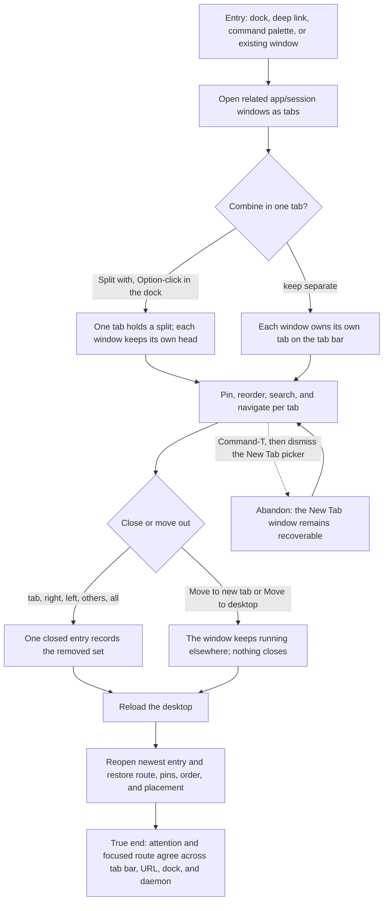

# J-organize-tabbed-work — Organize parallel work in tabs and splits

A keyboard-heavy operator keeps related app and session windows in tabs on the desktop tab bar,
combines some of them into splits, moves among them without losing route or attention state, closes
work at different scopes, and restores it after a reload.



```yaml
journey:
  id: J-organize-tabbed-work
  name: "Organize parallel work in tabs and splits"
  value_statement: "An operator can keep related work in tabs and splits, switch by meaning, and recover closed context without losing route or attention state."
  personas: [Bruno, Théo, Cora]
  entry_points:
    - url: "web / via dock, tab bar, command palette, keyboard shortcut, or deep link"
      origin: in-app-nav
    - url: "web /tasks, /marketplace, and /agents/{name}/sessions/{id}"
      origin: direct
  actions:
    - step: 1
      verb: "Open several related app or session instances"
      expected_observable: "Each semantic instance is addressable once; a dock click goes to the app's open window or opens it in a new tab."
    - step: 2
      verb: "Combine windows with the tab menu's Split with ▸ or an Option-click in the dock"
      expected_observable: "One tab holds the split with both bodies mounted and a head per window (Move to new tab, Close window); when the split cannot fit its members' minimum sizes it shows one member at a time with a member switcher."
    - step: 3
      verb: "Pin, reorder, search, and drill into individual tabs"
      expected_observable: "Pinned tabs remain a prefix; palette and shortcuts activate the existing tab without replacing its route depth."
    - step: 4
      verb: "Close one scope, reload, and reopen"
      expected_observable: "Reopen closed tab restores the newest closed entry with its original ids, routes, navigation stacks, pins, order, and split placement."
  goal:
    observable: "The tab bar, URL, dock, and daemon identify the same active work before and after reload."
    side_effects: [topology-committed, closed-entry-recorded, route-history-retained]
  true_end_state: "Restored work is focused in the expected tab and split position, its attention remains truthful, and unrelated windows are unchanged."
  exit:
    natural: "The operator continues from the restored tab at its prior route."
  abandonment:
    - at_step: 3
      how: "Open a new tab with Command-T and dismiss its picker before choosing an app."
      resume: "The New Tab window remains visible and can be completed or closed without topology loss."
  crosses: [web-shell, window-manager, sessions, routing, accessibility, persistence]
```

qa-impact: 2026-11-13 window-tabs-split S10. Tab frames, decks, groups and minimize were retired: each
desktop has one tab bar, a tab holds one window or a split, and a window only opens or closes. The
flow and steps 1, 2 and 4 now combine windows with Split with ▸ or an Option-click in the dock,
close at tab, left, right, others or all scope, move a window out with Move to new tab or Move to
desktop, and restore with Reopen closed tab; the New Tab abandonment moved to step 3. Walk with
ET-window-tab-pinning and ET-web-window-routing-lifecycle.
