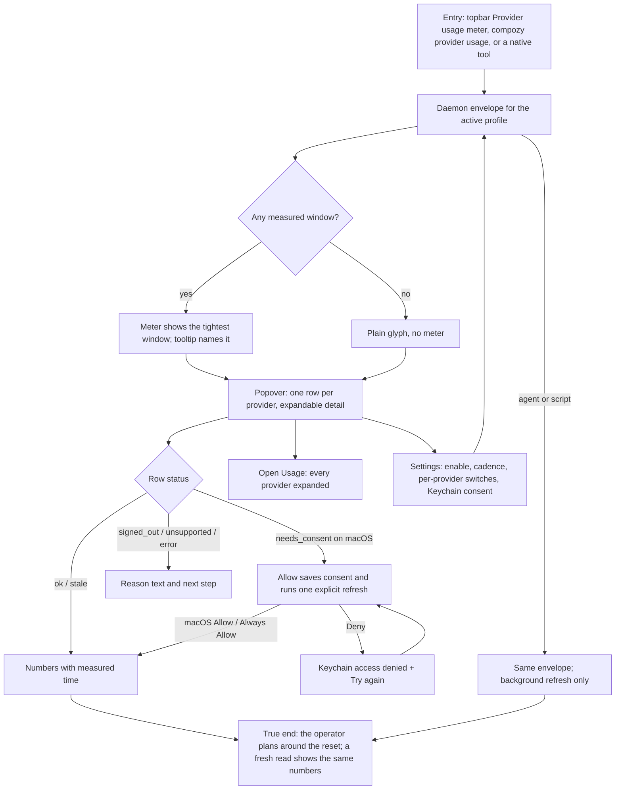

# J-provider-usage: Know how much subscription is left before a long run

An operator glances at the topbar to see the most constrained provider limit, opens the popover or
the Usage app for every window, refreshes on demand, grants Claude Keychain consent on macOS once,
and turns off providers they do not use. Agents and scripts read the same profile-scoped envelope
through the CLI, HTTP/UDS, and native tools. Nothing renders a fabricated number, and background
work never prompts.



```yaml
journey:
  id: J-provider-usage
  name: Know how much subscription is left before a long run
  value_statement: "An operator sees every provider's limits and resets inside CompozyOS without a login, browser, or surprise OS prompt."
  personas: [Bruno, Ada]
  entry_points:
    - url: topbar Provider usage control
      origin: in-app-nav
    - url: compozy provider usage list|refresh
      origin: cli
    - url: compozy__provider_usage_list / compozy__provider_usage_refresh
      origin: agent
  actions:
    - step: 1
      verb: Glance, open the popover, expand a row
      expected_observable: Tightest window, percent, reset countdown, and per-window detail match the daemon envelope
    - step: 2
      verb: Refresh, allow Claude Keychain access on macOS
      expected_observable: Explicit refresh fills rows; background refresh never prompts
    - step: 3
      verb: Change cadence, turn a provider off, turn the feature off
      expected_observable: Views and collection follow the applied settings live
  goal:
    observable: Truthful usage for the active profile in the tray, popover, Usage app, CLI, and tools
    side_effects: [settings apply records for changed provider_usage keys]
  true_end_state: A fresh read in every surface shows the same revision and numbers
  exit:
    natural: Popover closed with focus back on the meter
  abandonment:
    - at_step: 2
      how: Deny the macOS Keychain prompt
      resume: Try again on the row starts one new explicit read
  crosses: [web, desktop, cli, provider-usage-api, settings-api, native-tools]
```
