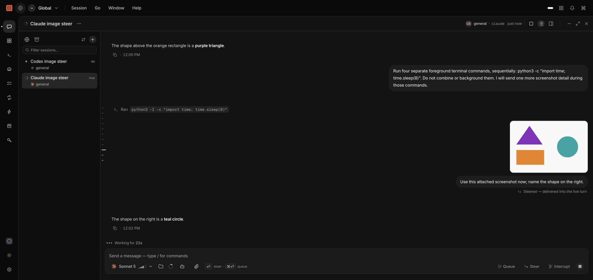
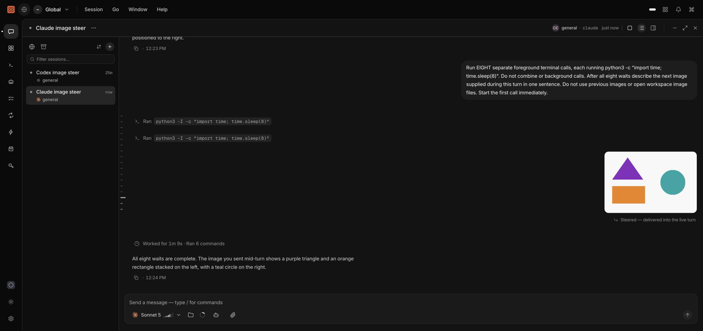

# QA Run Report — 2026-10-18 — Steer with attachments

Scope: issue #788; images/files sent while a turn runs, including queue promotion. Targeted run on
`fix/issue-788-steer-attachments`, using a Go binary built from the working tree and a Web dev server.
Daemon state, HTTP port, socket and workspace were isolated. Claude and Codex retained their declared
native authentication home policies. The user's host daemon was not restarted.

Persona: Théo, correcting an agent with a screenshot. Journey J-13; scenarios RT-session-live-steer
and RT-019. Tour: data integrity and truthful feedback. Canary: ordinary queued delivery.

| Journey | Surface | Status | Evidence |
| --- | --- | --- | --- |
| Identify an unseen image sent during an active Claude turn | CLI/API/provider | Pass | Same-turn injected receipt and independent history; all shapes/colors/positions identified |
| Identify the same unseen image sent during an active Codex turn | CLI/API/provider | Pass | Same-turn injected receipt and independent history; all shapes/colors/positions identified |
| Submit an attachment-bearing draft with Enter | Web | Pass | Steer enabled, draft and attachment consumed after acknowledgement, inline delivery feedback, correct response |
| Promote queued image into the active turn | CLI/Web/API | Fixed | CLI queued an image; Web promotion delivered it, emptied the queue, retained the image and Steered provenance |
| Send `--steer --attachment` and retry the same identities | CLI/UDS | Pass | Same queue entry/turn on retry, `replayed: true`; one delivery |
| Persist image and delivery provenance through reload/restart | Web/CLI | Pass | Lab restart plus fresh history read; screenshot below |
| Queue/admission attachments and changed retry identities | SQLite/manager suites | Pass | Focused race-enabled canonical suites |
| Interrupt fallback, rebind and parked-input ordering | Real ACP subprocess integration | Pass | `TestManagerIntegrationSteerFallback` |

## Session debriefs

Claude Code / Sonnet 5 and Codex / GPT-6.1-Sol both received a 480×320 image during an active turn.
Neither prompt described its contents or permitted opening workspace image files. Both identified a
purple triangle at upper left, an orange rectangle below it and a teal circle on the right. Both
reported `steer_delivery: injected` with the original turn ID.

The Web walk uploaded the image through the native file picker, entered a message and pressed Enter
while Claude ran foreground terminal commands. The composer cleared only after acknowledgement and
rendered “Steering — delivered into the live turn”; history retained the image with “Steered”. Claude
answered that the right-hand shape was a teal circle.

The first queue-promotion walk exposed a second client guard: its enabled button returned silently
when the queued input carried attachments. After removing that guard and extending the canonical
route-hook mutation test, a fresh walk promoted the image during the live turn. CLI readback showed an
empty queue; Claude answered that the shape above the rectangle was a purple triangle. The previous
ordinary queued image also dispatched successfully at its natural turn boundary.

The final binary accepted `session prompt --steer --attachment`; a same-key retry returned the same
turn and entry with `replayed: true`. No new prompt was dispatched. Existing attachment metadata and
history survived a restart of the isolated lab and a fresh Web load.

## Review remediation re-walk

Greptile identified that image-only queue promotion still returned HTTP 400 because the request DTO
required text before the manager could inspect stored attachments. The existing HTTP regression
reproduced the failure before the fix. Promotion now validates request identity at ingress and leaves
content validation to the queue, which owns the attachment snapshot and still rejects truly empty
input. Focused HTTP, queue, manager and OpenAPI compatibility race suites passed.

A fresh real Web walk queued an image with no text during Claude's eight foreground waits, then
clicked Steer. The queue disappeared, the image rendered with live-turn Steered provenance, and an
independent CLI read confirmed an empty queue. Claude answered: "The image you sent mid-turn shows a
purple triangle and an orange rectangle stacked on the left, with a teal circle on the right."

The CodeRabbit CLI follow-up rejects blank attachment paths, including a blank path after another
file, before uploading anything. Unsupported JSONL busy-input actions also reject before upload.
The five canonical regressions failed before the fix and passed afterward; the real binary rejected
all five inputs with the intended errors using the isolated home. Existing valid JSONL streaming and
attachment-bearing steer tests still pass.

A subsequent outside-diff finding exposed late validation of explicit identity pairs. The common CLI
submission path now resolves the identity once before uploads, then passes the same IDs to ordinary,
steer and JSONL delivery. Three existing identity regressions reproduced unwanted uploads before the
fix and passed afterward with zero uploads. The real binary rejected all three invalid pairs with the
intended errors; the positive explicit-identity case retains its attachment and exact IDs.

## Verification

- Focused Web suites: 19 passed; the queue-promotion follow-up suite passed 5 selected cases.
- Focused manager/ACP/SQLite/CLI/HTTP suites passed with the race detector. Captured ACP requests
  include image, text-resource and PDF blocks; manager cases cover immediate and delayed fallback,
  pending confirmation, durable attachment identity and changed-key-content conflicts.
- `TestManagerIntegrationSteerFallback` passed with the real ACP helper process.
- Web typecheck passed after building its existing `@compozy/client` dependency.
- React Doctor final changed-file scan: 100/100, zero findings. The PR check is tracked separately.
- `make codegen` and `make codegen-check` passed. OpenAPI, generated clients, CLI reference and the
  native-tool catalog are co-shipped. SQLite already permits attachment-bearing steer rows, so no
  schema migration is needed.
- Changed Go test cases pass the convention heuristics; older ACP findings outside changed hunks
  remain unchanged.
- No heavy local gate, broad Go test run, full E2E suite or desktop build was run. PR CI owns those
  delivery gates.

## Runtime and tooling observations

The first browser-control binding timed out. A screenshot attempt against an unrelated selected
window was rejected by automatic approval review; all subsequent captures targeted the isolated lab.
The extension's automatic file upload lacked local-file access, so the existing native file picker
was used for the named QA image without changing extension permissions. No product workaround was
needed. One early wait prompt was backgrounded by Claude; the final Web walks used four separate
foreground eight-second waits to keep the turn active deterministically.

## Limitations and final status

The scoped real-provider and Web journeys passed. Both installed providers advertise live injection;
interrupt fallback is backed by the focused manager suite and real ACP subprocess integration.
Mobile layout, other providers, Windows and full E2E were not re-walked locally. Required current-head
CI and CodeRabbit/Greptile/React Doctor completion are tracked in the PR. The strict lab audit passed with zero blockers and warnings. Manifest-scoped teardown completed
with `clean: true` and no surviving lab processes; only this run's registered processes were stopped.
