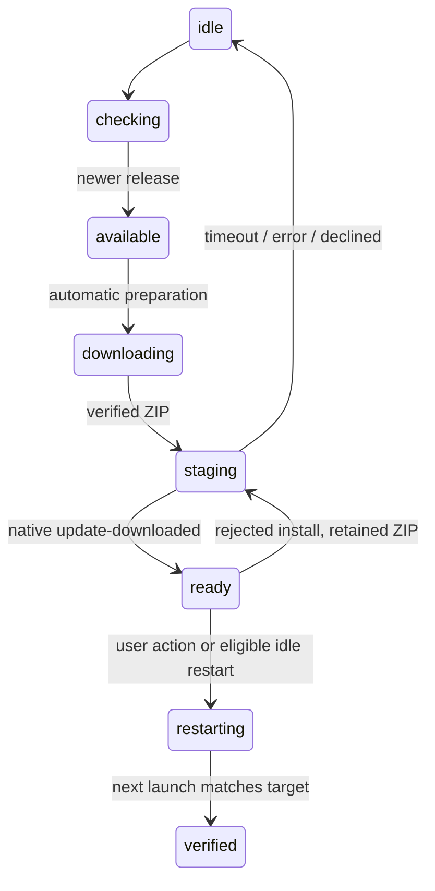

# Grok Bot update reverse engineering

Inspected on 2026-10-21 using REA and read-only extraction of the installed
`/Applications/Grok Bot.app`. This report describes shipped code, not an observed
Grok Bot upgrade. The installed application was not launched, updated, or modified.

## Artifact and evidence

- Bundle: Grok Bot 0.75.0, identifier `com.anysphere.sand`, stable track.
- Package build timestamp: `2026-10-21T16:11:38.972Z`.
- ASAR SHA-256: `1035db7b1f77974c78e6c18a4426a5fe16c639946335f7d57badfd0761971a5e`.
- Main application module: `dist/electron-main/main-app.cjs`, 3,169,724 bytes,
  SHA-256 `649a10ee9a090457647c150a0260f780308504224ce5d7a89e3f9c4a2b326884`.
- REA application evidence:
  `ev_4d6a7b53009271d03f99c81113f74bb41d72f09e491157c45fed2203ee9e8507`.
- REA selected-module evidence:
  `ev_0bd17bc093277a28e03396f9fc144d616104542e2c63377e9d277e9d0b9fe33f`.
- Machine-readable identity, coverage, and limitations:
  [grok-rea-evidence.json](grok-rea-evidence.json).

REA parsed 759 JavaScript files without parse failures. Whole-application semantic
coverage was partial: large bundled files exceeded graph-projection budgets, and
some semantic analyses were not started. The selected main module retained static
AST facts. Focused behavior below was established by reading the actual packaged
module, including complete method bodies, rather than interpreting absent graph
edges as absent behavior.

The first REA call rejected inconsistent ASAR integrity entries for unpacked native
files. A second call explicitly used `record-and-continue`, preserving those
contradictions as untrusted. Nine native entries were affected; their signatures,
execution, and provenance were not verified. This report makes no native-code
claims about those entries. The updater observations concern the hashed JavaScript
module and the declared Electron interface.

## Shipped update flow

The main module contains a dedicated update service with a single state owner.
Its normal macOS sequence is:

1. `start` schedules an initial check after 30 seconds and periodic checks using a
   one-hour base interval. `fetchUpdate` has a 30-second deadline, sends a
   no-cache request for the effective release track/platform/current version,
   and interprets HTTP 204 as no update.
2. `checkForUpdates` serializes checks and automatically calls `downloadAndStage`
   for a newer eligible offer. Package-managed installations and an app on a
   read-only volume take explicitly different paths.
3. `downloadAndStage` downloads into a temporary staging directory, reports
   received/total bytes, and checks the offered digest when present. Aborted or
   retargeted downloads are removed. The macOS payload is a ZIP.
4. `stageSquirrelZip` starts a local feed server over the verified ZIP, calls
   Electron's native `autoUpdater.setFeedURL` and `checkForUpdates`, and starts a
   ten-minute staging deadline. The application remains alive during this phase.
5. Only native `update-downloaded` causes `onSquirrelStaged` to record the staged
   version and enter `ready`. A completed network transfer is not treated as
   permission to close the process.
6. `quitAndInstall(expectedVersion)` rejects superseded or unready requests,
   coalesces pending relaunch requests, and optionally drains in-flight local
   execution. `restartSquirrel` records the attempt and invokes native
   `quitAndInstall` for an already staged version.

Source anchors in the original module: `checkForUpdatesExplicitly` near byte
3,092,316; `quitAndInstall` near 3,093,413; `stageSquirrelZip` contains
`setFeedURL` near 3,105,239; `onSquirrelStaged`, `startStagingTimeout`, and
`recoverRejectedApply` are named methods in the same update service. The local
readable extraction is `.cache/update-research/grok-artifact/main-app.cjs`;
formatting changed its line positions, not the original ASAR.

## Recovery is internal to the updater

- `onSquirrelError` handles both native `error` and `update-not-available`. During
  staging it clears the local server/timer/staging artifacts, returns to idle
  with a recorded error, and allows a later check.
- `startStagingTimeout` follows the same recovery path when staging never
  completes; it does not leave a permanently occupied user-facing operation.
- `recoverRejectedApply` discards a rejected staged installation and first tries
  a retained, verified ZIP for the exact version. Otherwise it fetches again.
  One explicit retry may continue automatically; a set of rejected versions
  prevents an unbounded same-version automatic loop.
- A durable apply marker records mechanism, from/to versions, trigger, attempt,
  and lifecycle observations. Startup calls `settleApplyMarker`; invoking the
  installer is distinct from proving that the new version launched.
- Feed confirmation can withdraw a previously offered build. Retargeting and
  retry are checked against the current expected version rather than blindly
  applying whatever a mutable latest feed now returns.

These observations explain how a simple interaction can coexist with recovery.
They do not justify copying Grok Bot's entire service, ShipIt cache handling,
feature gates, telemetry, or idle-restart policy into Compozy.

## Implications for Compozy

The essential boundary to preserve is **verified payload → native installer
ready → quit → observe the new version**. A file download resolving and a
`quitAndInstall` call returning are intermediate steps. Keep the process alive
until the native updater owns termination, bound waits that can remain pending,
and make a failed attempt release its operation so the same control can retry.

Grok Bot usually downloads before offering restart. Compozy can meet the requested
single-action flow without adopting background downloads: one accepted Update
action can carry the same transaction through download, native preparation, and
restart. This is a design recommendation, not a claim that a Grok Bot runtime
upgrade was tested.

Electron documents that macOS auto-updates use Squirrel.Mac and that
`quitAndInstall` is valid only after native `update-downloaded`:
[Electron autoUpdater API](https://www.electronjs.org/docs/latest/api/auto-updater).
The exact behavior of Compozy's wrapper was checked separately against its pinned
`electron-updater@6.8.9` source, rather than assuming current upstream APIs match.
